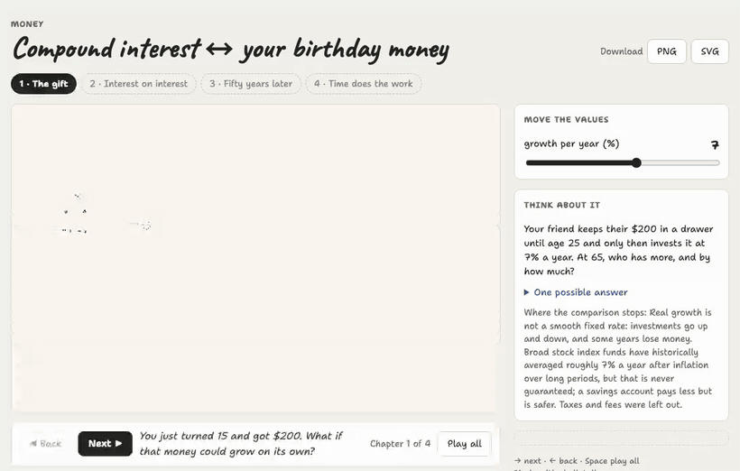
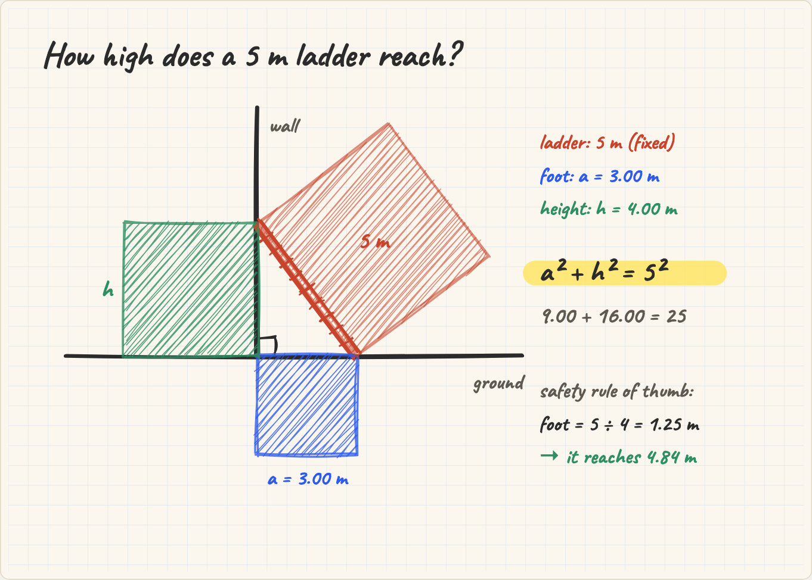
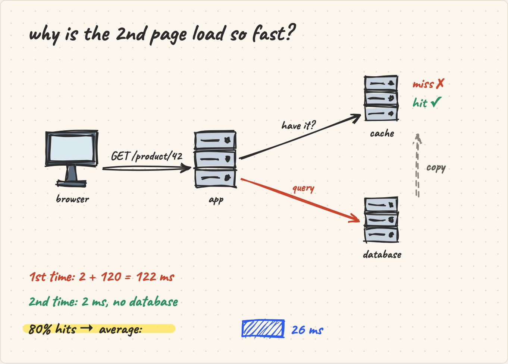
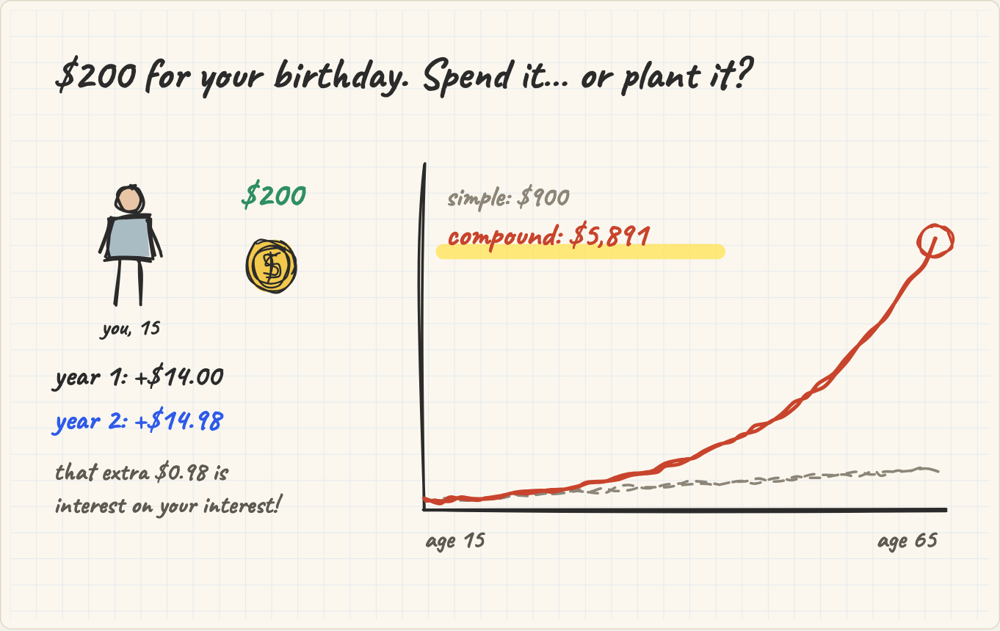
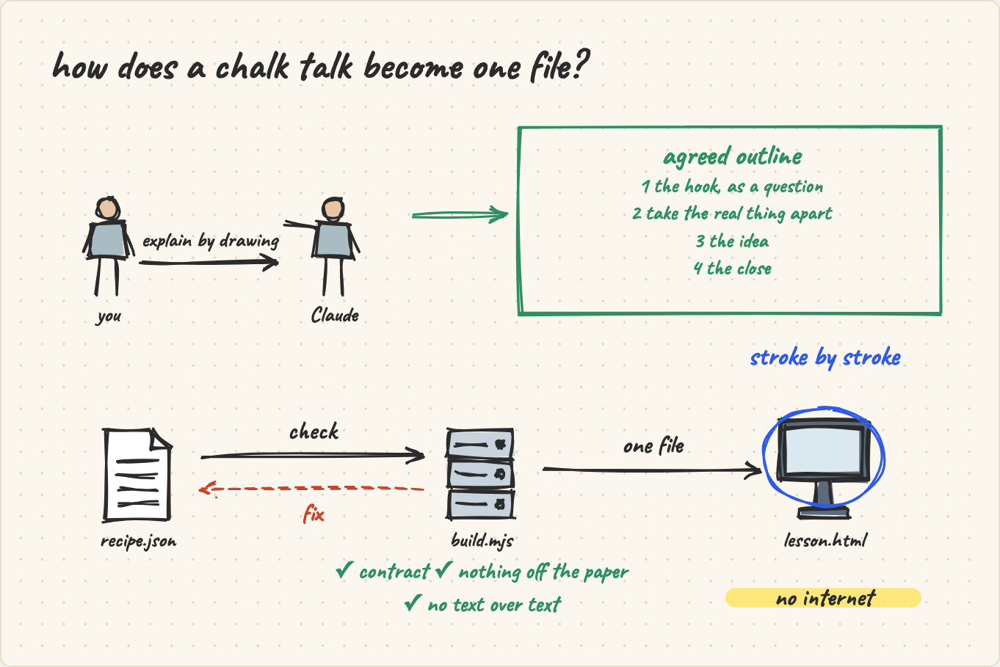
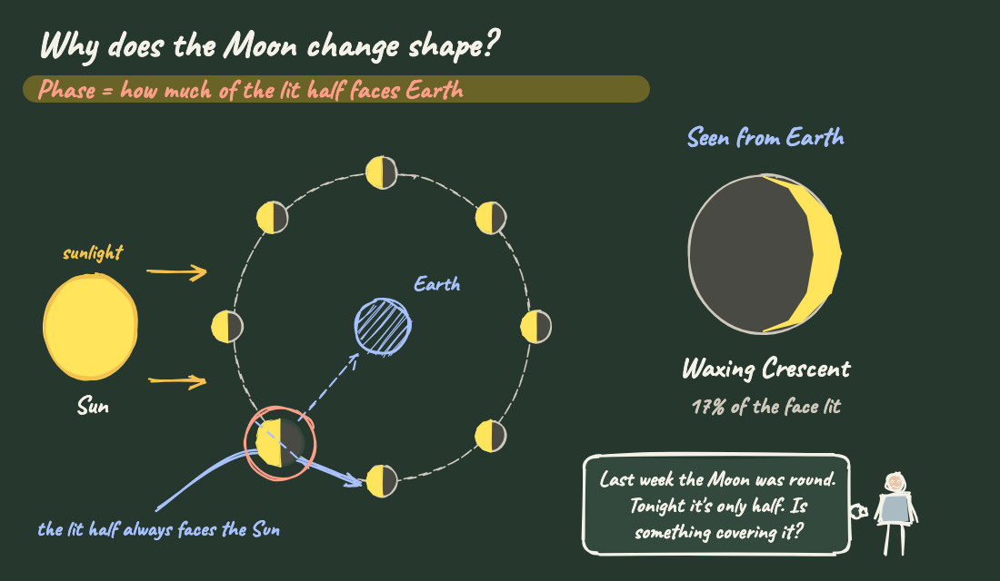
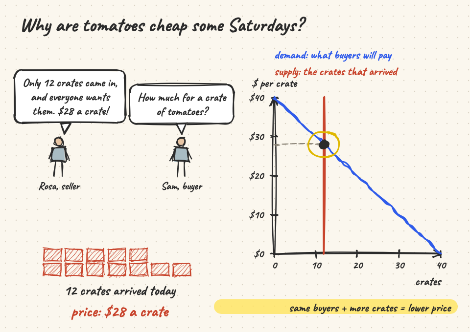
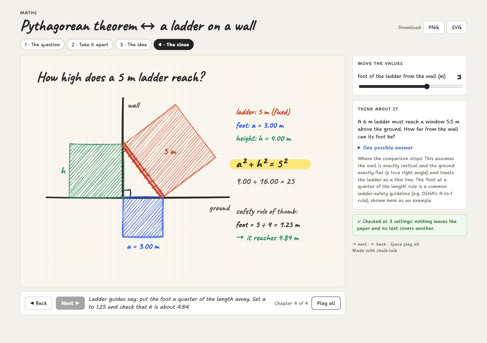
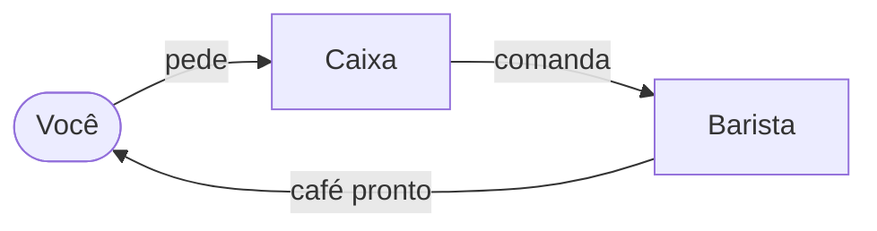

<h1 align="center">chalk-talk</h1>

<p align="center"><b>Ask Claude to explain something by drawing it — and get a hand-drawn lesson that draws itself.</b></p>

<p align="center">
  
</p>

<p align="center">
  An <a href="https://agentskills.io">Agent Skill</a> for Claude Code, claude.ai, the Claude API and other tools that load skills.<br>
  The lesson is <b>one HTML file</b>: it opens offline, has chapters, narration and values you can move.
</p>

---

## What it draws

Every drawing below was made by Claude with this skill, from the one-line request under it. Nothing was touched by
hand.

<table>
  <tr>
    <td width="50%"></td>
    <td width="50%"></td>
  </tr>
  <tr>
    <td><i>«Explain the Pythagorean theorem by drawing it, using a ladder leaning on a wall.»</i><br>Move the foot of the ladder: the blue and green squares change, their sum stays 25.</td>
    <td><i>«Can you draw how a web request with a cache works, for junior developers?»</i><br>Move the hit rate from 0 % to 90 % and watch the average time fall.</td>
  </tr>
  <tr>
    <td width="50%"></td>
    <td width="50%"></td>
  </tr>
  <tr>
    <td><i>«Explain compound interest by drawing it, for a teenager who just got birthday money.»</i><br>Interest on interest, mark by mark; move the yearly rate.</td>
    <td><i>«Explain by drawing how this very skill works.»</i><br>Yes — chalk-talk drew its own diagram. In the first build the check caught the circle crossing a label and Claude fixed it.</td>
  </tr>
  <tr>
    <td width="50%"></td>
    <td width="50%"></td>
  </tr>
  <tr>
    <td><i>«Explain why the Moon has phases by drawing it, for my 8th-grade science class. Make it work for the classroom.»</i><br>Claude chose the chalkboard, a question the lesson waits on, and a quiz at the end. Slide the day and the Moon goes round.</td>
    <td><i>«Explain supply and demand by drawing a conversation at a farmers market.»</i><br>Balloons for who speaks; move how many crates arrived and the price follows the demand line.</td>
  </tr>
</table>

**[Open the gallery](https://ruinosus.github.io/chalk-talk/)** to play every lesson in your browser. The recipes behind
these drawings are in [`docs/examples/`](docs/examples). Build any of them with
`node skills/chalk-talk/scripts/build.mjs docs/examples/web-cache.json`.

## The lesson you get

<p align="center"></p>

- **Chapters**: it opens on the first chapter and waits. *Next* draws the next part from where it stopped, *Play all*
  draws everything; the arrow keys and Space work too.
- **Narration**: one short sentence for each idea, under the paper.
- **Values to move**: sliders and switches beside the paper redraw it at once. Values only appear where there is a
  real quantity.
- **Think about it**: a new situation to think through, one possible answer, and where the comparison stops.
- **Checked**: when the file opens, it checks itself at the values' extremes. Nothing should leave the paper and no
  text should cover another.
- **Chalkboard**: a button turns the paper into a green board with chalk (or the recipe asks for it, for a class).
- **A question that waits**: the lesson can stop on a question until someone presses «Show me» — time for the class
  to answer.
- **Quiz** at the end: pick an option, see why it is right or not.
- **Narration** with the browser's own voice (off by default) and a **transcript** of everything the lesson says.
- **Download** the paper as PNG or SVG, or the lesson drawing itself as a **GIF** or a **video** (WebM) — for slides
  and messages.
- **Language**: the page speaks English or Portuguese, following the browser. Numbers in the drawing follow the
  recipe's language (`3.00` in English, `3,00` in Portuguese).
- **One file, about 265 KB**: engine, player, fonts and recipe are all inside. Open it without internet, send it by
  e-mail, project it in a class.

## How a conversation goes

A real conversation in Claude Code (translated from Portuguese and shortened):

> **You:** explain compound interest by drawing it, for my 14-year-old nephew
>
> **Claude:** Two things are missing — answer both at once.
> **1. Which everyday thing do we tie it to?** (1) the birthday money he saves *(recommended)* · (2) a snowball rolling
> downhill · (3) the credit-card bill nobody paid.
> **2. Which number does he move?** the yearly rate *(recommended)* · the years · none.
>
> **You:** you decide
>
> **Claude:** Birthday money, and he moves the yearly rate. Outline:
> 1. *The question* — R$ 1,000 saved at 14, left alone until 24: why R$ 2,594 and not R$ 2,000?
> 2. *Take it apart* — year by year: +100, then +110… the interest earns interest too.
> 3. *The idea* — simple (a straight line to 2,000) next to compound (a curve to 2,594); he moves the rate.
> 4. *The close* — the difference highlighted; "what if you start 5 years later?"; where the comparison stops.
>
> Shall I draw it?
>
> **You:** go
>
> **Claude:** *(writes the recipe, builds it, the check passes)* Ready: `juros-aniversario.html`. Press Next; in
> chapter 3 let him move the rate and watch the curve pull away from the line.

Claude asks only what is missing, never draws before you agree the outline, and changes only what you ask afterwards
(«make the arrow blue», «use 5 % instead»). Ask for several lessons and they come as **one course file**, with a list
to go from one to the next.

## Write it as text — or bring a Mermaid diagram

A recipe can be a few lines of text instead of JSON, right inside your Markdown:

````markdown
```chalk-talk
title Juntar moedas ↔ o cofrinho
theme chalkboard
param n "moedas por mês" 1..8 = 3

# O gancho
> A Ana guarda moedas todo mês.
person ana at 150,330 "Ana" mood=idea
text "quer poupar" right-of ana gap 16 align=start

# Desmontar
row at 470,150 gap 14
  repeat n: coin size 44
bank banco at 740,450 "banco"
ana -> banco "deposita"
```
````

And a Mermaid diagram you already have becomes a hand-drawn lesson — any of its 30 kinds (all of Mermaid 11.17 but
zenuml): flowcharts and sequences, gantt and timelines, mind maps, sankey, C4, wardley maps and the rest. The `%%` lines are comments for Mermaid, so the same block still shows as a normal diagram on GitHub:

````markdown

````

`node skills/chalk-talk/scripts/build.mjs page.md` turns every such block into a lesson. The whole syntax:
[references/text.md](skills/chalk-talk/references/text.md).

### In your docs site

On a docs site the lesson plays inside the page — ` ```chalk-talk ` for the text, ` ```chalk-mermaid ` for a Mermaid
diagram (a plain ` ```mermaid ` is left to the site). The `chalk-talk` npm package has a remark and a markdown-it plugin,
and the script that mounts the lessons. With Docusaurus:

```js
// docusaurus.config.js
import { remarkChalkTalk } from 'chalk-talk/markdown'
export default {
  // …
  presets: [['classic', { docs: { remarkPlugins: [remarkChalkTalk] } }]],
  clientModules: ['chalk-talk/mount.global.js'],
}
```

The lesson opens on chapter 1, drawn and still; **Expand** shows all of it. A VS Code extension and an Obsidian plugin
with the same blocks are on the way.

### On GitHub: an SVG that draws itself

GitHub shows no script in a README, but it shows an image — and an SVG can animate itself with CSS. `--svg` draws the
lesson into one:

```
npx chalk-talk coffee-order.mmd --svg      # → coffee-order.svg
```

<p align="center"></p>

It plays once when the page opens and stays as the finished drawing (still from the start for someone who asked for
less motion). It has no chapters, values or narration — link to the `.html` lesson for those. To keep the SVGs in step
with the recipes, a workflow like this one draws them on every push:

```yaml
name: Draw the chalk-talk SVGs
on:
  push:
    paths: ['**/*.chalk', '**/*.mmd']
permissions:
  contents: write
jobs:
  draw:
    runs-on: ubuntu-latest   # has Chrome, which draws them
    steps:
      - uses: actions/checkout@v4
      - uses: actions/setup-node@v4
        with: { node-version: 22 }
      - run: git ls-files '*.chalk' '*.mmd' | while read -r f; do npx -y chalk-talk@0.11.0 "$f" "${f%.*}.svg" --svg; done
      - run: |
          git config user.name github-actions
          git config user.email github-actions@users.noreply.github.com
          git add -A -- '*.svg'
          git diff --cached --quiet || { git commit -m "Draw the chalk-talk SVGs" && git push; }
```

## How it works

Claude never writes the drawing itself. It writes a small **recipe** — JSON that says what to draw, step by step:

```json
{ "id": "birthday-money", "title": "Compound interest ↔ your birthday money", "locale": "en-US",
  "params": { "rate": { "label": "growth per year (%)", "min": 3, "max": 10, "step": 1, "value": 7 } },
  "steps": [
    { "type": "text", "at": [40, 72], "text": "$200 for your birthday. Spend it… or plant it?", "size": 40,
      "chapter": "The gift", "say": "You just turned 15 and got $200. What if that money could grow on its own?" },
    { "type": "prop", "name": "person", "at": [110, 270], "size": 110, "label": "you, 15" },
    { "type": "prop", "name": "coin", "at": [240, 260], "size": 60 },
    { "type": "text", "at": [40, 345], "text": "year 1: +${i1:2}", "size": 28, "chapter": "Interest on interest" },
    …
```

Then `scripts/build.mjs` (plain Node, no dependencies):

1. **checks the contract**: step types, sizes, expressions, colours. A broken recipe stops here with a message
   Claude can act on (exit 1).
2. **builds one HTML file**: the player with the engine and fonts inside, plus the recipe.
3. **reviews the drawing** in a headless Chrome, Chromium or Edge, when one is installed. The drawing is checked
   hidden at each value's extremes: anything off the paper, text over text, a line through a text. Problems go back
   to Claude (exit 3), at most twice. Without a browser, the page checks itself when opened.

What a recipe can draw: text, lines and arrows, curves and polygons, circles, plots of a formula, a yellow marker,
labelled cards, 29 hand-drawn props (`person`, `house`, `bus`, `coin`, `phone`, `server`, `bank`, `school`, `hospital`,
`truck`, `database`, `robot`…) — a person can look happy, sad, surprised, worried or have an idea — repeated pieces (`repeat`), pieces that appear on a condition (`when`), movement (`move`), arrows
between named pieces (`link`), numbers that count up (`counter`), axes with marks (`axis`), timelines (`timeline`),
speech and thought balloons (`balloon`), curly braces (`brace`), handwritten notes with an arrow (`note`), tables
(`table`) and bars (`bars`). Positions can be expressions over the values, so the drawing follows the sliders — or be left to the
engine: `place` puts a piece beside another by name, and `row`, `column` and `grid` line pieces up. A piece that would
leave the paper comes back in on its own. The full contract is in
[`references/recipe.md`](skills/chalk-talk/references/recipe.md).

## Install

**Claude Code** (2.1.275 or later):

```
/plugin install chalk-talk --marketplace ruinosus/chalk-talk
```

Older versions: `/plugin marketplace add ruinosus/chalk-talk`, then `/plugin install chalk-talk@chalk-talk`. Or copy
`skills/chalk-talk` to `~/.claude/skills/`.

**claude.ai**: download `chalk-talk.zip` from the [latest release](https://github.com/ruinosus/chalk-talk/releases),
then Settings › Capabilities › Skills › Upload. Code execution must be on. The lesson comes back as a file to download.

**Claude API**: upload the same zip with the Skills API (`/v1/skills`) and use it with the code execution tool.

**Without installing anything** — on npm as [`chalk-talk`](https://www.npmjs.com/package/chalk-talk): a page needs
only the recipe and `<script src="https://cdn.jsdelivr.net/npm/chalk-talk@0.11.0/player.js"></script>` (that is also
how the skill shows a lesson where it cannot run code), and `npx chalk-talk lesson.json` builds the one-file lesson.

**Other tools** (Codex, GitHub Copilot, Cursor, Gemini CLI…): copy `skills/chalk-talk` to the folder where the tool
reads skills (for example `.agents/skills/`). The tool needs Node.js 18 or later.

> **Tip:** Claude picks a skill by its description. If you have a very long list of skills installed, Claude Code may
> show it only the names. In that case, call it by name: `/chalk-talk:chalk-talk explain … by drawing it` (or
> `/chalk-talk …` when the folder was copied to `~/.claude/skills/`).

## What is inside

```
skills/chalk-talk/
  SKILL.md                 how Claude runs the conversation
  references/              how to write a recipe, the molds, the hooks, seven example recipes
  scripts/build.mjs        checks a recipe and builds the HTML (Node 18+, no dependencies)
  scripts/contract.mjs     the recipe contract          ┐
  assets/player.html       the player, engine and fonts ┘ generated — do not edit
docs/                      the images and example recipes of this page
tools/                     builds the generated files, checks and packs the skill
```

The drawing engine uses [Rough.js](https://roughjs.com) (MIT) for the hand-drawn strokes. The fonts are
[Caveat](https://fonts.google.com/specimen/Caveat) and [Shantell Sans](https://fonts.google.com/specimen/Shantell+Sans)
(SIL Open Font License). All three are bundled into `assets/player.html`.

## Not yet

Voice narration, editing the drawing by hand, PDF export, and showing the lesson inline as a claude.ai artifact
(today it comes back as a file).

## Develop

```
cd tools && npm install
npm run assets    # rebuild the generated files from the engine's source (paths in tools/sources.json)
npm run check     # build every example and check the exit codes
npm run snapshots # draw every example in a headless browser and compare its SVG with tools/snapshots/
npm run zip       # dist/chalk-talk.zip for claude.ai and the API
npm run site      # the gallery in docs/ (GitHub Pages): every example as a lesson, with a picture
```

`assets/VERSION` says which engine version the generated files came from. The engine's source is not published
yet, so `npm run assets` only works where it is; everything else (`check`, `snapshots`, `site`, `zip`) works from
this repository alone.

The skill's own evals are in [`evals/`](evals): 20 requests in English and Portuguese (asking before drawing, drawing,
crowded papers, changing a lesson, requests that are not about drawing). They run with
[`claude plugin eval`](https://docs.claude.com/en/docs/claude-code), with and without the skill:

```
claude plugin eval . --allow-tools Bash Write Edit --runs 1 --max-cost-usd 15
```

Last run (0.6.1, one run per case): **0.94 with the skill, 0.31 without it** — without the skill Claude does not ask
what is missing, does not build the lesson and ends up drawing by hand. The evals grade the conversation and the
build (asks only what is missing, waits for the go, builds, checks, right language), not how good the drawing is.

## License

MIT
